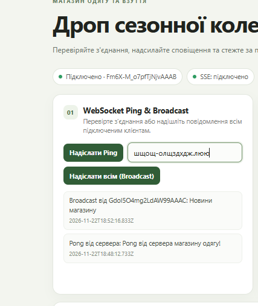
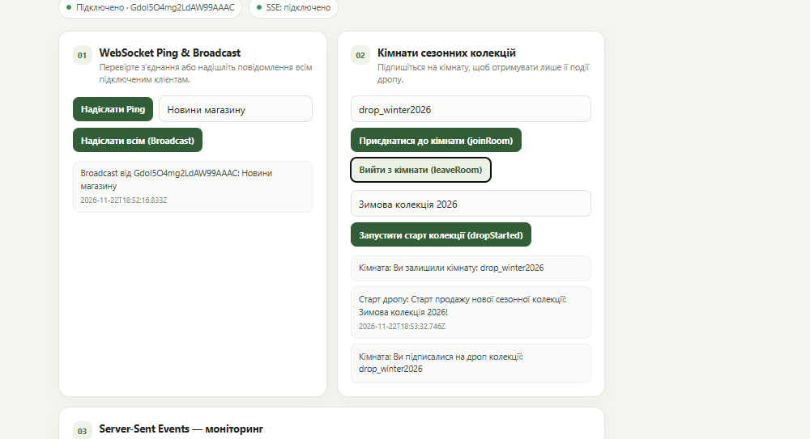
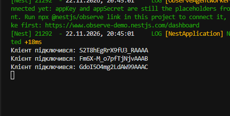

# Практична робота № 10
## Тема: Комунікація у реальному часі та система нотифікацій

**Виконала:** Тирканич Корнелія, група КН-41

---

## Мета роботи

Опанувати принципи організації двостороннього повнодуплексного зв’язку між клієнтом та сервером у реальному часі за допомогою протоколу WebSockets та бібліотеки Socket.IO у NestJS, навчитися конфігурувати WebSocket Gateways, обробляти події життєвого циклу клієнтських сокетів (`OnGatewayConnection`, `OnGatewayDisconnect`), працювати з механізмом широкомовлення (broadcasting) та ізольованими кімнатами (Rooms), а також реалізувати односторонню потокову передачу системних даних за допомогою протоколу Server-Sent Events (SSE) та реактивних потоків RxJS.

## Індивідуальний варіант № 3

**Домен: Інтернет-магазин одягу та взуття**

- Формат кімнати підписників: `drop_<collectionId>`.
- Подія кімнати: `dropStarted`.
- Призначення: сповіщення користувачів про початок продажу нової сезонної колекції одягу.

---

# 1. Хід виконання роботи

## 1.1. Ініціалізація проєкту та налаштування WebSocket Gateway (Рівень 1)

Було створено новий проєкт NestJS під назвою `pr-10-web`.

Для реалізації комунікації у реальному часі встановлено необхідні залежності:

- `@nestjs/websockets` — підтримка WebSocket у NestJS;
- `@nestjs/platform-socket.io` — інтеграція Socket.IO;
- `socket.io` — бібліотека для двостороннього обміну повідомленнями;
- `@nestjs/serve-static` — обслуговування статичних файлів клієнтського інтерфейсу.

Також згенеровано модуль сповіщень `NotificationsModule`.

У файлі `src/notifications/events.gateway.ts` реалізовано шлюз `EventsGateway` із декоратором:

```typescript
@WebSocketGateway({
  cors: {
    origin: '*',
  },
})
```

Шлюз забезпечує обмін повідомленнями між сервером та підключеними клієнтами.

### Обробка життєвого циклу підключень

Для контролю підключень реалізовано інтерфейси:

- `OnGatewayConnection` — обробка нового підключення клієнта;
- `OnGatewayDisconnect` — обробка відключення клієнта.

Під час підключення та відключення сервер фіксує унікальний `client.id` у консолі та оновлює лічильник активних WebSocket-з'єднань.

### Реалізація Ping / Pong

Для перевірки зв'язку створено обробник:

```typescript
@SubscribeMessage('ping')
```

Клієнт надсилає подію `ping`, після чого сервер повертає подію `pong` із поточним серверним часом (timestamp).

Це дозволяє перевірити доступність сервера та швидкість обміну повідомленнями.

### Широкомовне сповіщення (Broadcasting)

Реалізовано обробник:

```typescript
@SubscribeMessage('broadcastNotification')
```

Він приймає текстове повідомлення від клієнта та транслює його всім підключеним користувачам за допомогою:

```typescript
this.server.emit('globalAlert', data);
```

У результаті всі активні клієнти отримують однакове глобальне сповіщення без необхідності оновлення сторінки.

## 1.2. Робота з цільовими кімнатами (Rooms) за варіантом № 3 (Рівень 2)

Для адресного інформування покупців про початок продажу сезонних колекцій реалізовано механізм ізольованих кімнат Socket.IO.

Формат назви кімнати:

```text
drop_<collectionId>
```

Приклад:

```text
drop_winter2026
```

### Підписка на кімнату — joinRoom

Для підключення користувача до кімнати реалізовано обробник:

```typescript
@SubscribeMessage('joinRoom')
```

Сервер формує ідентифікатор кімнати та додає клієнта за допомогою:

```typescript
client.join(roomId);
```

Після успішної підписки клієнт отримує підтвердження через подію `roomJoined`.

### Вихід із кімнати — leaveRoom

Для відключення від сповіщень конкретної колекції реалізовано:

```typescript
@SubscribeMessage('leaveRoom')
```

Використовується метод:

```typescript
client.leave(roomId);
```

Після виходу користувач більше не отримує повідомлення, адресовані цій кімнаті.

### Сповіщення про початок продажу колекції — dropStarted

Для відправлення повідомлень конкретним підписникам реалізовано метод:

```typescript
emitToRoom(
  roomId: string,
  event: string,
  data: any,
)
```

Також створено обробник `triggerDrop`, який надсилає подію:

```typescript
this.server
  .to(roomId)
  .emit('dropStarted', data);
```

Таким чином, повідомлення про початок продажу нової сезонної колекції отримують лише користувачі, які підписалися на відповідну кімнату.

Наприклад, після запуску колекції «Зима 2026» повідомлення отримують клієнти кімнати `drop_winter2026`, тоді як інші користувачі залишаються ізольованими від цього сповіщення.

## 1.3. Потокова передача даних через Server-Sent Events (SSE)

Для реалізації одностороннього потоку системних повідомлень створено контролер:

`src/notifications/notifications.controller.ts`

У ньому реалізовано ендпоінт:

```typescript
@Sse('events/stream')
```

Повна адреса запиту:

```http
GET /notifications/events/stream
```

Для генерації повідомлень використано реактивні оператори RxJS:

- `interval(5000)` — створює нову подію кожні 5 секунд;
- `map()` — перетворює кожну подію на об'єкт із системною інформацією.

Потік передає клієнту такі дані:

- статус сервера `ONLINE`;
- поточну кількість активних WebSocket-підключень;
- точний серверний час.

SSE забезпечує автоматичне надходження оновлень від сервера до браузера без постійного надсилання HTTP-запитів клієнтом.

## 1.4. Створення клієнтського інтерфейсу тестування

У директорії `public` створено файл `client.html`, який використовується для перевірки роботи WebSocket та SSE.

Для взаємодії з сервером підключено бібліотеку `socket.io-client` та браузерний API `EventSource`.

Інтерфейс містить три основні блоки.

### Блок 1. WebSocket Ping & Broadcast

Забезпечує:

- відображення стану підключення до сервера;
- відображення унікального `socket.id`;
- надсилання події `ping`;
- отримання відповіді `pong`;
- відправлення глобальних повідомлень `broadcastNotification`;
- відображення отриманих подій у динамічному списку `<ul>`.

### Блок 2. Кімнати сезонних колекцій

Дозволяє користувачу:

- вводити ідентифікатор колекції;
- підписуватися на кімнату `drop_winter2026`;
- залишати кімнату;
- ініціювати подію початку продажу `dropStarted`;
- отримувати адресні сповіщення про старт нової колекції.

### Блок 3. SSE-моніторинг

Автоматично підключається до потоку:

```text
/notifications/events/stream
```

За допомогою `EventSource` браузер отримує системні оновлення кожні 5 секунд та відображає:

- поточний статус сервера;
- кількість активних підключень;
- серверний час отримання події.

Усі три блоки працюють без перезавантаження вебсторінки.

---

# 2. Результати тестування в реальному часі

Після запуску NestJS-сервера було відкрито клієнтський інтерфейс:

```text
http://localhost:3000/client.html
```

Для перевірки механізмів комунікації одночасно використовувалися декілька вкладок браузера.

## 2.1. Перевірка WebSocket-підключень

Під час відкриття та закриття вкладок перевірено роботу методів `handleConnection` та `handleDisconnect`.

У терміналі сервера зафіксовано підключення трьох клієнтів:

```text
S2T8hEgRrX9fU3_RAAAA
Fm6X-M_o7pfTjNjvAAAB
GdoI5O4mg2LdAW99AAAC
```

У результаті підтверджено правильну роботу життєвого циклу WebSocket-з'єднань та оновлення лічильника активних клієнтів.

## 2.2. Перевірка Ping / Pong

Під час натискання кнопки «Надіслати Ping» браузер відправляв подію `ping`.

Сервер миттєво повертав подію `pong` із серверним timestamp.

Результат: успішний двосторонній обмін повідомленнями.

## 2.3. Перевірка Broadcasting

З однієї вкладки браузера було відправлено глобальне повідомлення через `broadcastNotification`.

Усі активні вкладки отримали подію `globalAlert` та відобразили однакове повідомлення.

Результат: широкомовна розсилка працює коректно.

## 2.4. Перевірка кімнат Rooms

Для тестування використано кімнату:

```text
drop_winter2026
```

Після підписки клієнтів на кімнату було ініційовано початок продажу сезонної колекції «Зима 2026».

У результаті:

- підписані клієнти отримали подію `dropStarted`;
- непідписані клієнти не отримали повідомлення;
- ізоляція кімнат працювала відповідно до заданого варіанта.

Результат: адресне інформування підписників реалізовано успішно.

## 2.5. Перевірка Server-Sent Events

Для тестування SSE було використано потік:

```http
GET /notifications/events/stream
```

Протягом перевірки надходили повідомлення з такими часовими позначками:

```text
18:55:34
18:55:39
18:55:44
```

Інтервал між повідомленнями становив 5 секунд.

Кожне повідомлення містило статус `ONLINE` та кількість активних WebSocket-підключень — `3`.

Результат: потокова передача системних даних через SSE працює коректно.

## 2.6. Загальна таблиця результатів тестування

| Механізм / Подія | Протокол | Дія під час тестування | Отриманий результат |
|---|---|---|---|
| `handleConnection` / `handleDisconnect` | WebSocket | Відкриття та закриття вкладок | Зафіксовано підключення та відключення клієнтів |
| `ping` → `pong` | WebSocket | Надсилання Ping | Миттєва відповідь із серверним часом |
| `broadcastNotification` → `globalAlert` | WebSocket | Відправлення глобального повідомлення | Повідомлення отримали всі активні вкладки |
| `joinRoom` | WebSocket Rooms | Підписка на `drop_winter2026` | Отримано підтвердження `roomJoined` |
| `leaveRoom` | WebSocket Rooms | Вихід із кімнати | Клієнт перестав отримувати повідомлення кімнати |
| `dropStarted` | WebSocket Rooms | Запуск продажу колекції | Сповіщення отримали лише підписники |
| `/notifications/events/stream` | SSE | Пасивний моніторинг | Оновлення статусу кожні 5 секунд |

---

# 3. Скріншоти виконання роботи










---

# 4. Висновки

У ході виконання практичної роботи № 10 було розроблено систему комунікації у реальному часі для інтернет-магазину одягу та взуття на базі фреймворку NestJS.

Було створено WebSocket-шлюз `EventsGateway` із підтримкою життєвого циклу підключень клієнтів, реалізовано двосторонній обмін повідомленнями `ping/pong` та механізм широкомовної розсилки `globalAlert`.

Для індивідуального варіанта № 3 реалізовано ізольовані кімнати формату `drop_<collectionId>`, які дозволяють надсилати адресні сповіщення користувачам про початок продажу нових сезонних колекцій за допомогою події `dropStarted`.

Також було впроваджено потокову передачу системних даних через Server-Sent Events (SSE) із використанням декоратора `@Sse()` та реактивних операторів RxJS `interval()` і `map()`.

Для перевірки функціональності створено клієнтський інтерфейс `client.html`, який дозволяє тестувати WebSocket-підключення, широкомовні повідомлення, кімнати та SSE-моніторинг.

У результаті роботи закріплено практичні навички реалізації двосторонньої комунікації через WebSockets, адресного інформування користувачів за допомогою Rooms та односторонньої потокової передачі даних через SSE.

---

**Технології:** TypeScript, NestJS, Node.js, WebSockets, Socket.IO, Server-Sent Events (SSE), RxJS, HTML, JavaScript.